<div align="center">

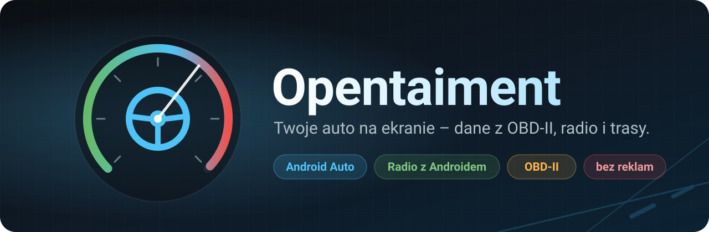

<br>

[](https://github.com/prisma-studios71/Opentaiment/actions/workflows/build.yml)


[](https://github.com/prisma-studios71/Opentaiment/actions/workflows/build.yml)

**[Funkcje](#-funkcje)** · **[Android Auto](#-jak-to-działa-z-android-auto)** · **[Radio z Androidem](#-radio-z-androidem-albo-tablet-w-desce)** · **[Instalacja](#-instalacja-telefon)** · **[Dla programistów](#-dla-programistów)**

</div>

---

**Opentaiment** pokazuje to, czego nie ma w Android Auto: **dane z auta przez OBD-II**. Spalanie, koszt jazdy,
eco-score, moc, błędy silnika, historia tras i zabawki na tor – na telefonie i na ekranie auta.
A jeśli zamiast Android Auto masz **radio z Androidem albo tablet w desce**, Opentaiment staje się całym radiem:
launcher, radio internetowe, muzyka z pendrive'a, przyciski na kierownicy i start razem z zapłonem.

> 🔒 Bez reklam, bez kont, bez śledzenia – wszystko zostaje na Twoim urządzeniu.

<table>
<tr>
<td width="50%" valign="top">

### 📱 Telefon + Android Auto
Muzyka i nawigacja zostają w Android Auto, a Opentaiment dostaje **własną ikonę w menu aplikacji**
i ekrany z danymi z auta. Telefon może leżeć zablokowany w uchwycie.

`app-phone` · `car`

</td>
<td width="50%" valign="top">

### 🚘 Radio z Androidem / tablet
Pełnoekranowy launcher jak fabryczne radio: **radio internetowe**, pliki z USB, zegary, opony,
serwis, głośność zależna od prędkości i reakcja na zapłon.

`app-headunit` · `feature/player`

</td>
</tr>
</table>

<div align="center">
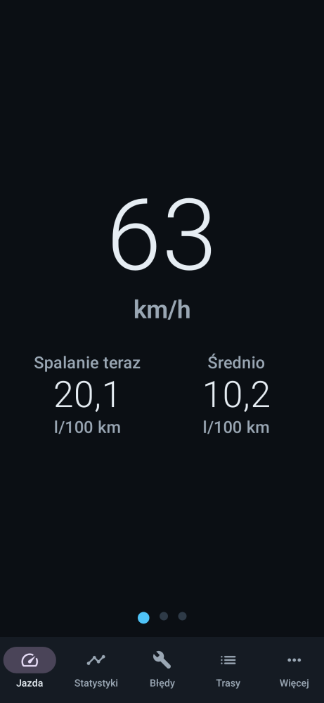&nbsp;
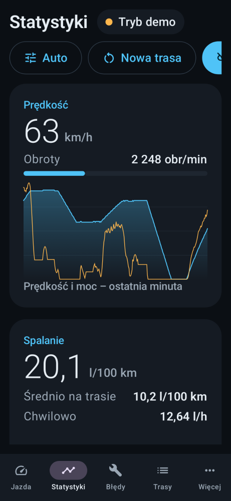&nbsp;
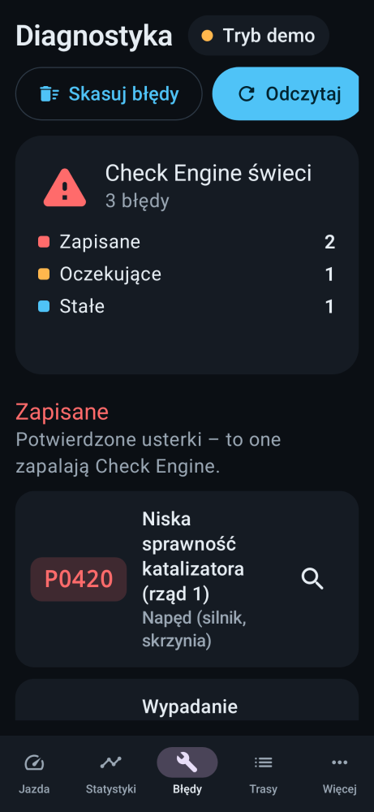&nbsp;
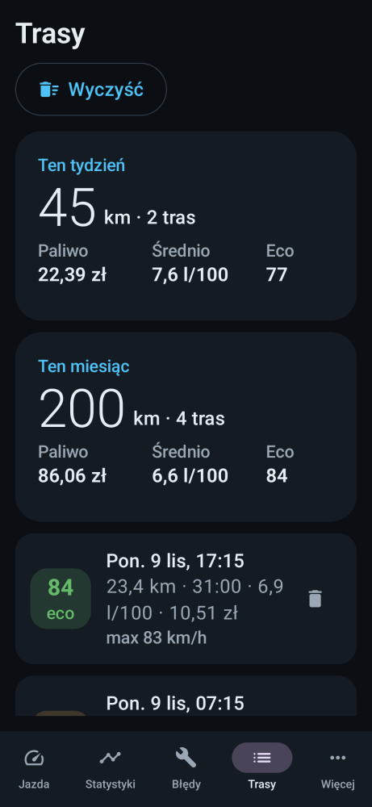
<br>
<sub>Jazda · Statystyki · Błędy silnika · Trasy</sub>
</div>

## ✨ Funkcje

<table>
<tr>
<td width="33%" valign="top">

#### ⛽ Dane z auta
- Spalanie chwilowe i średnie (PID 5E, MAF albo MAP), odcięcie paliwa
- **Koszt paliwa** każdej trasy
- **Eco-score 0–100** z podpowiedziami
- Moc, moment, przyspieszenie (z fizyki)
- Temperatury, napięcie, wykres ostatniej minuty
- **Alerty**: przegrzanie, gorący olej, brak ładowania, słaby akumulator, mało paliwa

</td>
<td width="33%" valign="top">

#### 🛠️ Diagnostyka i serwis
- **Błędy silnika**: zapisane / oczekujące / stałe, ~80 opisów po polsku, kasowanie
- **Freeze frame** z chwili błędu
- **Gotowość do badania spalin**
- **Przypomnienia serwisowe**: olej, przegląd, OC, rozrząd – po km i datach
- **Ciśnienie w oponach** (czujniki TPMS na BLE)

</td>
<td width="33%" valign="top">

#### 🗺️ Trasy
- **Historia tras** zapisuje się sama
- Podsumowania tygodnia i miesiąca
- **Ślad GPS** z mapką (kolor = prędkość)
- **Eksport GPX** i **CSV** (prosto do Excela)
- Trasa przetrwa nagłe odcięcie prądu

</td>
</tr>
<tr>
<td valign="top">

#### 🏁 Wyścig <sub>(tylko na torze!)</sub>
- 0–100, 80–120 km/h, **¼ mili** z prędkością na mecie
- **Okrążenia GPS** – linia mety jednym kliknięciem
- **G-meter** – zakręty, ruszanie, hamowanie
- **Zegary**: obroty, prędkość, doładowanie turbo, temperatury, napięcie

</td>
<td valign="top">

#### 📻 Radio i muzyka
- **Radio internetowe** z [radio-browser.info](https://www.radio-browser.info) – ~50 tys. stacji
- Popularne w Polsce, wyszukiwarka, ulubione, własne strumienie
- Tytuł utworu, wznawianie po utracie zasięgu
- **Muzyka z pendrive'a / karty** po folderach

</td>
<td valign="top">

#### 🎨 Wygląd i wygoda
- **Automatyczny tryb nocny** od zachodu słońca
- 6 kolorów akcentu
- Ekran „Jazda” – jedna wielka liczba
- Widżety i kafelki do ułożenia po swojemu
- Adaptery **OBD na BLE**, samo-reconnect

</td>
</tr>
</table>

<div align="center">
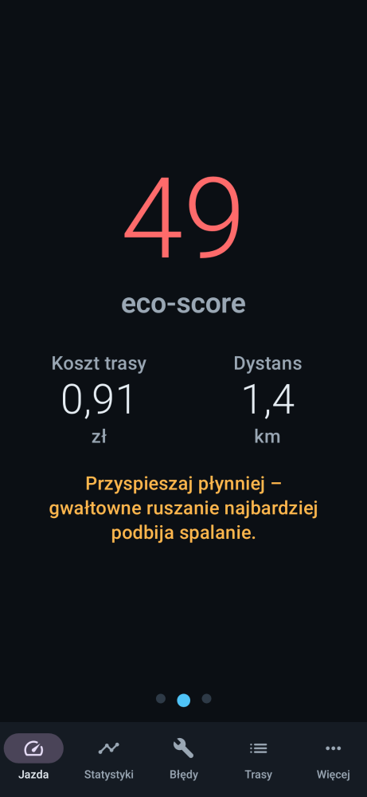&nbsp;
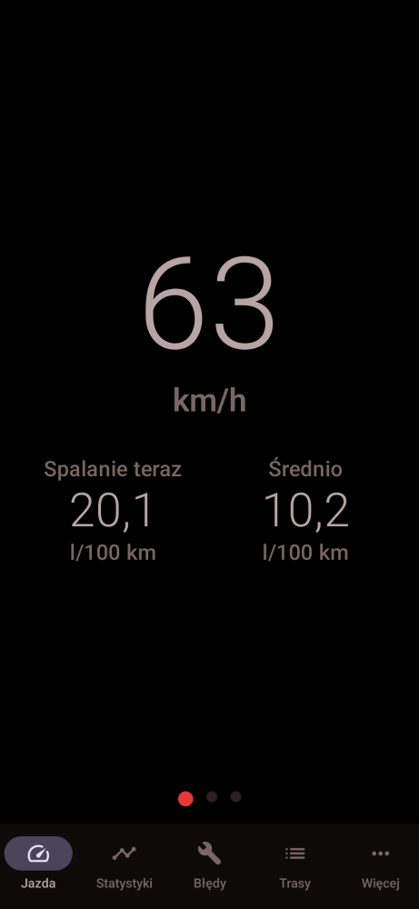&nbsp;
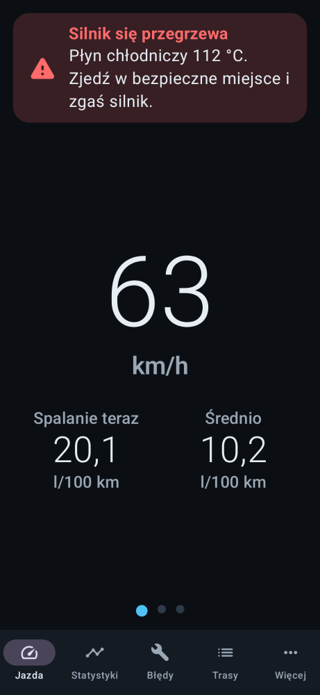&nbsp;
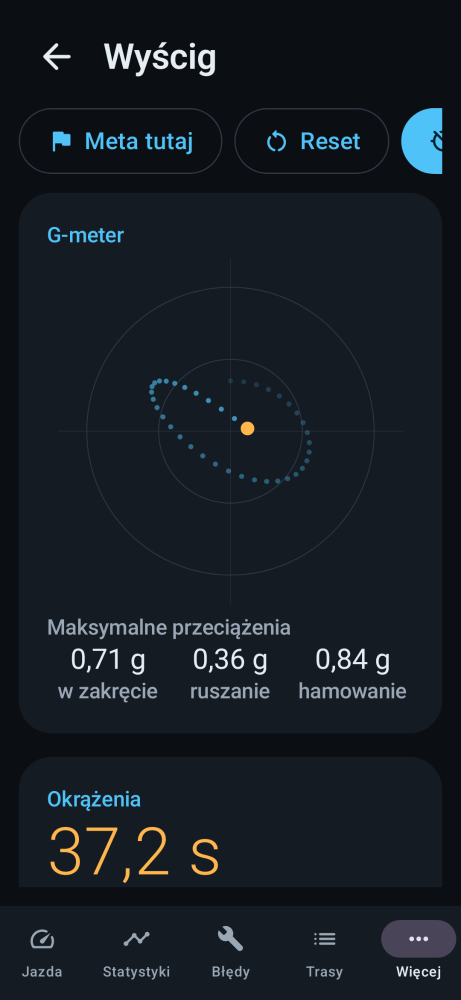&nbsp;
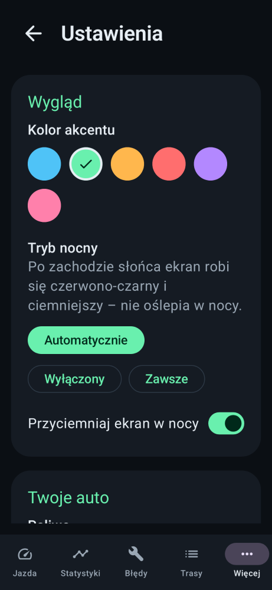&nbsp;
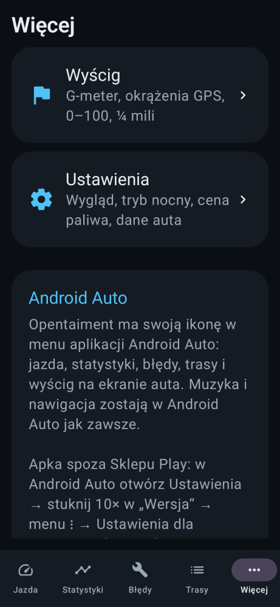
<br>
<sub>Eco-score · Tryb nocny · Ostrzeżenie · Wyścig · Ustawienia · Więcej</sub>
</div>

## 🚗 Jak to działa z Android Auto

Android Auto nie pozwala żadnej aplikacji rysować po swoim ekranie. Opentaiment dostaje więc
**własną ikonę w menu aplikacji Android Auto** i własne ekrany:

| Ekran w aucie | Co pokazuje |
|---|---|
| 🚘 **Jazda** | prędkość, obroty, spalanie chwilowe i średnie, eco-score z podpowiedzią, koszt i dystans trasy, ostrzeżenia |
| 📊 **Statystyki** | moc i moment, przyspieszenie, temperatury, akumulator, poziom paliwa, trasa |
| 🛠️ **Diagnostyka** | Check Engine, kody błędów z opisami, gotowość do badania spalin, kasowanie błędów |
| 🗺️ **Trasy** | podsumowanie tygodnia i miesiąca, ostatnie jazdy |
| 🏁 **Wyścig** | 0–100, 80–120, ¼ mili, okrążenia GPS, przeciążenia |
| 🔌 **Połączenie** | połącz z adapterem / tryb demo / rozłącz |

Ostrzeżenia (przegrzanie, brak ładowania, mało paliwa…) wyskakują jako alert na ekranie auta
i powiadomienie na telefonie.

> [!NOTE]
> Ekrany Android Auto rysuje sam Android Auto z gotowych szablonów Google, więc wyglądają
> „po androidowemu”, a nie jak na zrzutach z telefonu – i odświeżają się co sekundę.

## 📦 Co potrzebujesz

| | Wymagania |
|:---:|---|
| 📱 | Telefon z Androidem 8+ i auto z Android Auto – **albo** radio / tablet z Androidem 8+ |
| 🔌 | **Adapter ELM327** na Bluetooth lub BLE („kostka OBD”, ~30–80 zł) w gnieździe OBD-II – każda benzyna od 2001, diesel od 2004 (UE) |
| 🛞 | <sub>Opcjonalnie:</sub> czujniki ciśnienia w oponach **TPMS BLE** (te do apki „TPMS II”) |

## 📲 Instalacja (telefon)

1. Pobierz APK: **[Actions](https://github.com/prisma-studios71/Opentaiment/actions/workflows/build.yml) → ostatni build → artefakt `opentaiment-phone-debug`**
   albo zbuduj: `./gradlew :app-phone:assembleDebug`
2. Zainstaluj, wejdź w **Statystyki → Połącz OBD** i wybierz adapter
   (klasyczny Bluetooth najpierw sparuj w ustawieniach, PIN zwykle 1234 lub 0000; BLE znajdziesz przyciskiem „Szukaj”).
   Bez auta? Kliknij **Demo**.
3. **Włącz aplikacje spoza Sklepu Play w Android Auto** (jednorazowo):
   Android Auto → Ustawienia → stuknij 10× w **„Wersja”** → menu **⋮** → **Ustawienia dla programistów**
   → zaznacz **„Nieznane źródła”**.
4. Podłącz telefon do auta – Opentaiment jest w menu aplikacji Android Auto.
   Przy kolejnych jazdach łączy się z adapterem sam.

> [!TIP]
> W **Więcej → Ustawienia** ustaw cenę paliwa, rodzaj paliwa, masę i pojemność silnika –
> od tego zależą koszt, moc i spalanie.

## 📻 Radio z Androidem (albo tablet w desce)

Dla aut bez Android Auto ten sam kod działa jako **pełnoprawne radio samochodowe** (`app-headunit`).
APK: artefakt `opentaiment-tablet-debug`.

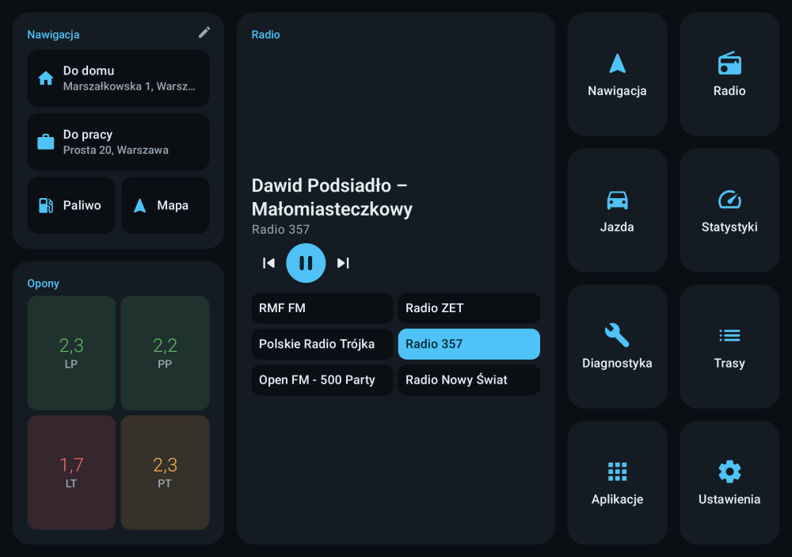

<table>
<tr>
<td width="50%" align="center">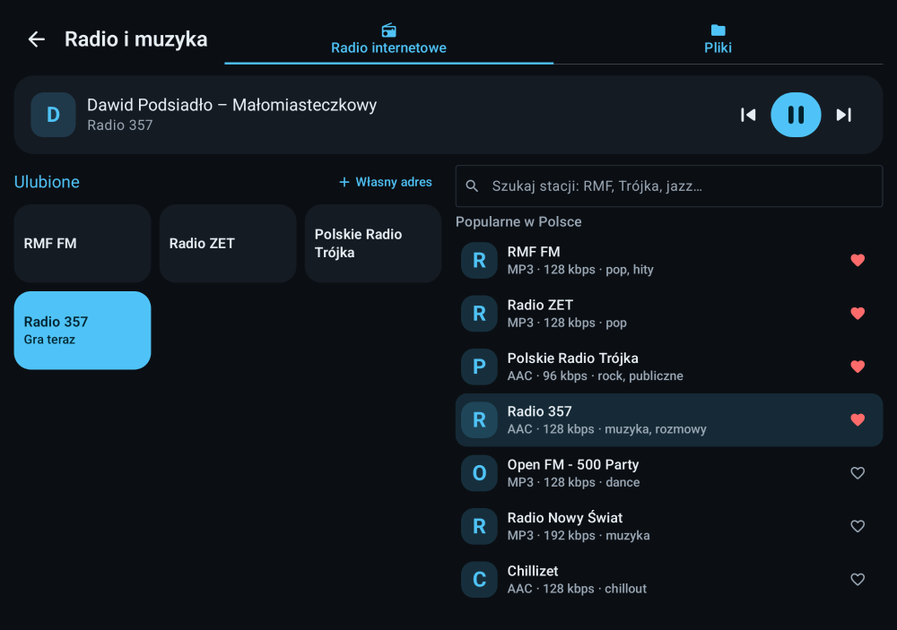<br><b>Radio internetowe</b></td>
<td width="50%" align="center">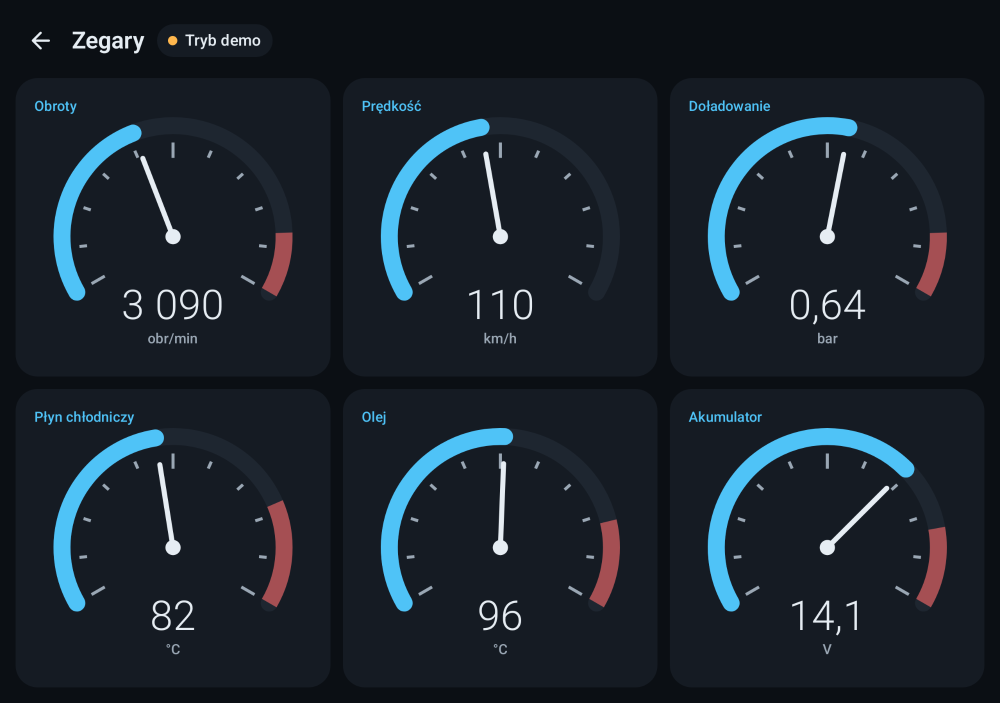<br><b>Zegary</b></td>
</tr>
<tr>
<td width="50%" align="center">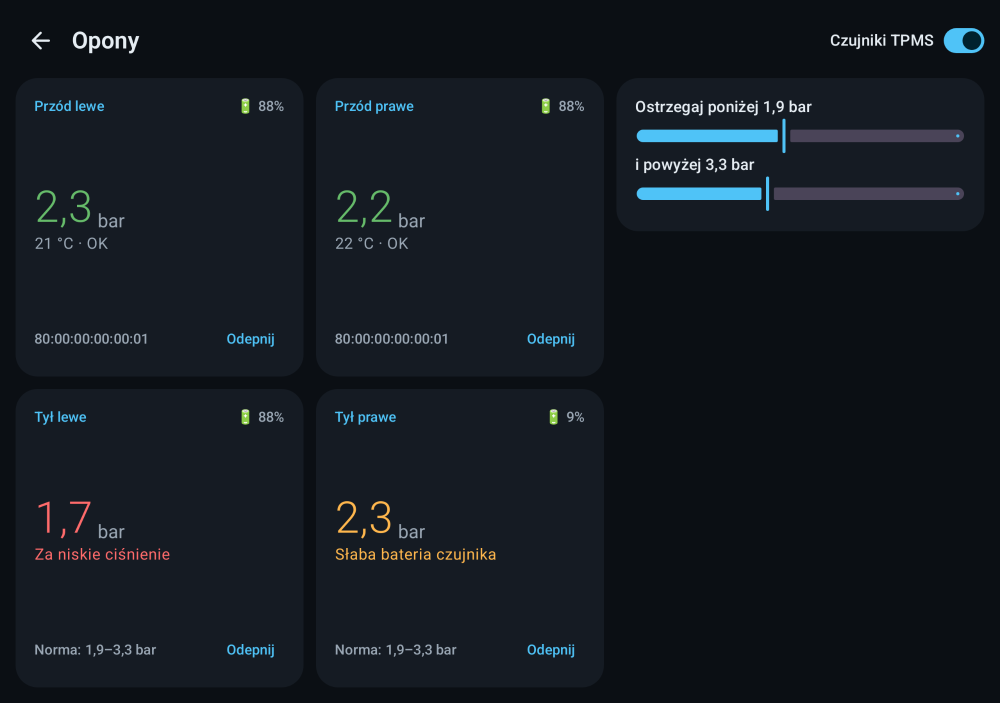<br><b>Ciśnienie w oponach</b></td>
<td width="50%" align="center">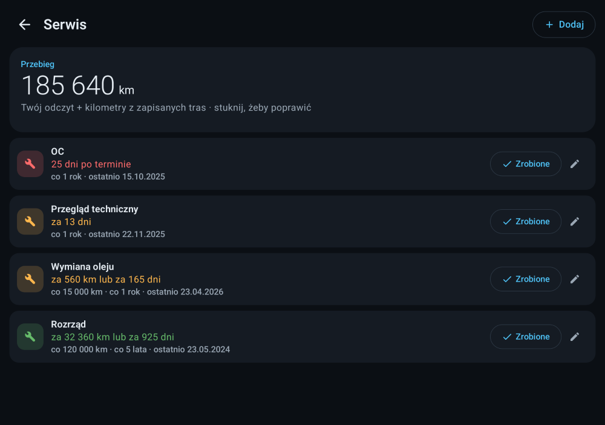<br><b>Przypomnienia serwisowe</b></td>
</tr>
<tr>
<td width="50%" align="center">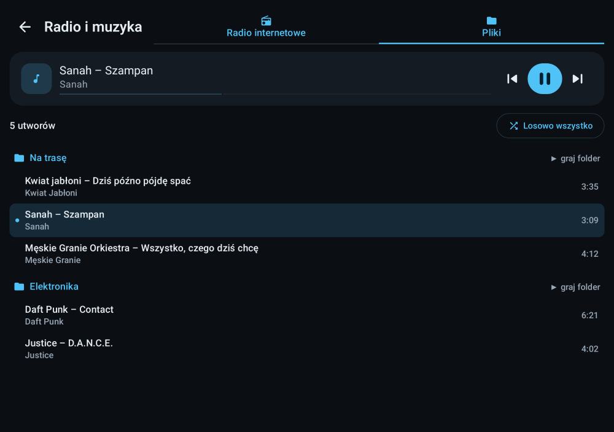<br><b>Muzyka z pendrive'a</b></td>
<td width="50%" align="center">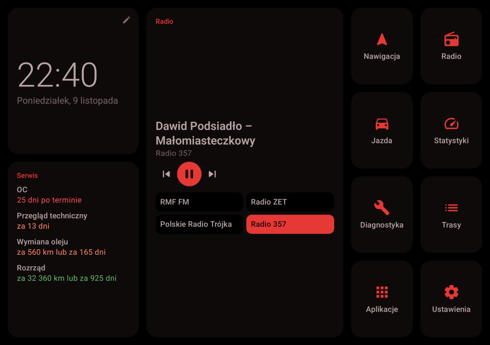<br><b>Tryb nocny</b></td>
</tr>
</table>

#### 🔑 Jak fabryczne radio

| Funkcja | Co robi |
|---|---|
| 🔋 **Start z autem** | po włączeniu radia łączy się z OBD i włącza ostatnią stację |
| ⚡ **Zapłon = zasilanie USB** | dla tabletu na ładowarce: odcięcie prądu zapisuje trasę i pauzuje muzykę |
| 🎛️ **Przyciski na kierownicy** | „Naucz przycisk” → wciśnij → wybierz akcję; z usługą dostępności działa też nad innymi apkami |
| 🔊 **Głośność od prędkości** | lekko / średnio / mocno – z OBD, a bez niego z GPS |
| 🌗 **Jasność dzień / noc** | dla całego systemu, nie tylko Opentaiment |
| 💬 **Dymek nad nawigacją** | prędkość i spalanie nad Mapami / Waze, czerwony przy ostrzeżeniu |
| 🧭 **Widżet nawigacji** | do domu, do pracy, stacje paliw w pobliżu |
| 🏠 **Ekran główny** | przy pierwszym starcie proponuje, że zostanie launcherem |

#### ⚙️ Jak ustawić radio

1. Zainstaluj APK. Przy pierwszym starcie Opentaiment zaproponuje, że zostanie **ekranem głównym**
   (launcherem) – kliknij „Ustaw”. Później: **Ustawienia → Tablet → Ustaw jako ekran główny**.
   W części chińskich radyj launcher wybiera się w ustawieniach fabrycznych („Default launcher”).
2. **Ustawienia → Radio samochodowe**: włącz to, czego chcesz. Przy jasności, dymku i przyciskach
   Android poprosi o osobne zgody („Modyfikowanie ustawień systemu”, „Wyświetlanie nad innymi aplikacjami”,
   usługa dostępności „Opentaiment – przyciski na kierownicy”).
3. Głośność od prędkości bez OBD i ślad GPS tras potrzebują **dokładnej lokalizacji**.
4. Czujniki opon: **Opony → Czujniki TPMS**. Czujniki z numerami 1–4 przypiszą się same.

<details>
<summary><b>📸 Ustawienia radia</b></summary>
<br>
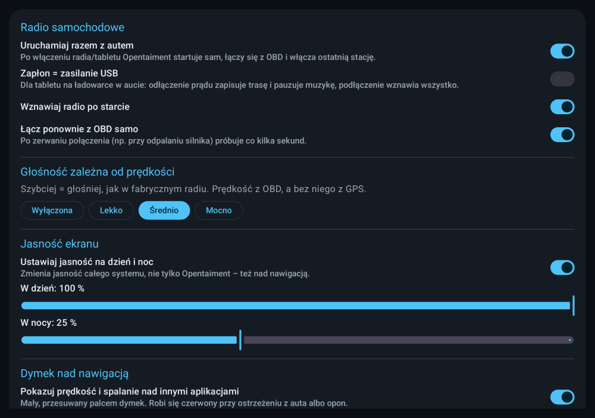
</details>

## ⚠️ Uczciwie o ograniczeniach

<details>
<summary><b>Dane z auta</b></summary>

- **Moc i moment są szacowane** z prędkości, masy auta i oporów – zwykłe OBD ich nie podaje. Najdokładniej przy pełnym gazie na płaskim.
- **Spalanie w dieslu bez PID 5E** liczone z przepływomierza jest zawyżone (diesel pracuje na ubogiej mieszance).
- Zwykły ELM327 czyta **błędy silnika** ze standardowego OBD-II; ABS, poduszki czy klimatyzacja zwykle wymagają protokołów producenta.
- Dystans ¼ mili liczony jest z prędkości z OBD (jak licznik w aucie), a przeciążenia boczne z GPS – to dobre przybliżenia, nie pomiar z toru.
- Aplikacja nie jest w Sklepie Play, dlatego w Android Auto trzeba włączyć „Nieznane źródła”.

</details>

<details>
<summary><b>Radio z Androidem</b></summary>

- **Przyciski na kierownicy** w części chińskich radyj (MCU) nie docierają do Androida jako zwykłe klawisze –
  wtedy przypisz je w ustawieniach producenta do przycisków multimediów, a Opentaiment je zobaczy.
- **Zapłon**: radia, które przy zgaszeniu auta tylko „usypiają”, nie wysyłają sygnału startu – Opentaiment łączy się
  ponownie po wybudzeniu ekranu. Opcja „Zapłon = zasilanie USB” jest dla tabletów na ładowarce.
- **Launcher**: aplikacja nie może sama, po cichu, zostać ekranem głównym – Android zawsze pyta użytkownika.
  Część chińskich radyj po restarcie wymusza swój launcher; wtedy ustaw go w ustawieniach fabrycznych.
- Czujniki TPMS: obsługiwany jest najpopularniejszy format tanich czujników BLE („TPMS II”). Fabryczne czujniki
  auta (433 MHz) wymagają innego odbiornika.
- Mapka trasy to sam kształt przejazdu (bez podkładu mapy, działa offline) – ulice zobaczysz po otwarciu GPX w apce z mapą.
- Radio internetowe zużywa ~60 MB transferu na godzinę przy 128 kbps.

</details>

## 💻 Dla programistów

<table>
<tr><td>

```
app-phone/        📱 telefon: zakładki, usługa w tle, powiadomienia
car/              🚗 ekrany Android Auto (Car App Library 1.7)
app-headunit/     📻 radio / tablet: launcher, usługa w tle, zapłon,
                     kierownica, głośność, jasność, dymek
core/ui/          🎨 motywy, tryb nocny, komponenty
feature/vehicle/  🔌 OBD-II (ELM327 BT/BLE), obliczenia, trasy + GPS,
                     alerty, TPMS, serwis, wyścig, ekrany Compose
feature/player/   🎵 radio internetowe i pliki (Media3)
feature/media|weather|apps/   moduły launchera
```

</td></tr>
</table>

| Zadanie | Komenda |
|---|---|
| 🔨 APK na telefon | `./gradlew :app-phone:assembleDebug` |
| 🔨 APK na radio / tablet | `./gradlew :app-headunit:assembleDebug` |
| ✅ Testy logiki i ekranów Android Auto | `./gradlew testDebugUnitTest` |
| 📸 Zrzuty ekranu bez emulatora (Paparazzi) | `./gradlew recordPaparazziDebug` |

**Stack:** Kotlin · Coroutines + Flow · Jetpack Compose (Material 3) · Car App Library · Media3 / ExoPlayer ·
Bluetooth SPP + BLE GATT · JUnit · Robolectric · Paparazzi

📐 Plan i architektura: **[docs/PLAN.md](docs/PLAN.md)**

---

<div align="center">
<sub>Zrobione z ❤️ dla kierowców, którzy chcą wiedzieć, co się dzieje pod maską. Jedź bezpiecznie 🚦</sub>
</div>
