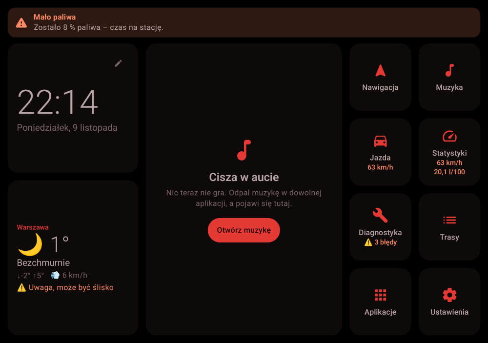
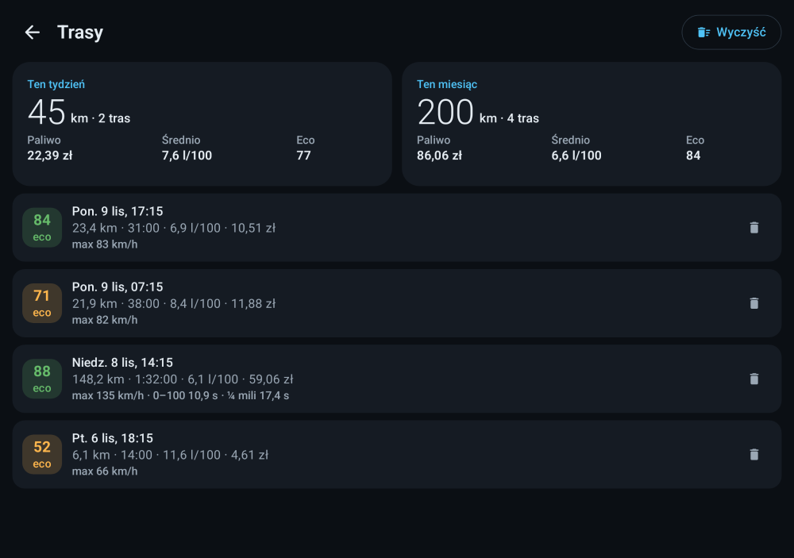

# Opentaiment

**Dodatek do Android Auto**, który pokazuje to, czego Android Auto nie ma: dane z auta przez OBD-II.
Spalanie, koszt jazdy, eco-score, moc, błędy silnika, historia tras i zabawki na tor – na telefonie
i na ekranie auta. Muzyka i nawigacja zostają w Android Auto, tak jak zawsze.

Bez reklam, bez kont, bez śledzenia – wszystko zostaje na telefonie.


## Jak to działa z Android Auto

Android Auto nie pozwala żadnej aplikacji rysować po swoim ekranie. Opentaiment dostaje więc
**własną ikonę w menu aplikacji Android Auto** i własne ekrany:

| Ekran w aucie | Co pokazuje |
|---|---|
| **Jazda** | prędkość, obroty, spalanie chwilowe i średnie, eco-score z podpowiedzią, koszt i dystans trasy, ostrzeżenia |
| **Statystyki** | moc i moment, przyspieszenie, temperatury, akumulator, poziom paliwa, trasa |
| **Diagnostyka** | Check Engine, kody błędów z opisami, gotowość do badania spalin, kasowanie błędów |
| **Trasy** | podsumowanie tygodnia i miesiąca, ostatnie jazdy |
| **Wyścig** | 0–100, 80–120, ¼ mili, okrążenia GPS, przeciążenia |
| **Połączenie** | połącz z adapterem / tryb demo / rozłącz |

Ostrzeżenia (przegrzanie, brak ładowania, mało paliwa…) wyskakują jako alert na ekranie auta
i powiadomienie na telefonie.

> Ekrany Android Auto rysuje sam Android Auto z gotowych szablonów Google, więc wyglądają
> „po androidowemu”, a nie jak na zrzutach z telefonu – i odświeżają się co sekundę.

## Co potrzebujesz

- Telefon z Androidem 8+ i auto z Android Auto (albo sam telefon w uchwycie)
- **Adapter ELM327 na Bluetooth** („kostka OBD”, ~30–80 zł) w gnieździe OBD-II
  (każda benzyna od 2001, diesel od 2004 w UE)

## Instalacja

1. Pobierz APK: **Actions → ostatni build → artefakt `opentaiment-phone-debug`**
   albo zbuduj: `./gradlew :app-phone:assembleDebug`
2. Zainstaluj na telefonie, wejdź w **Statystyki → Połącz OBD** i wybierz adapter
   (najpierw sparuj go w ustawieniach Bluetooth, PIN zwykle 1234 lub 0000).
   Bez auta? Kliknij **Demo**.
3. **Włącz aplikacje spoza Sklepu Play w Android Auto** (jednorazowo):
   Android Auto → Ustawienia → stuknij 10× w **„Wersja”** → menu **⋮** → **Ustawienia dla programistów**
   → zaznacz **„Nieznane źródła”**.
4. Podłącz telefon do auta – Opentaiment jest w menu aplikacji Android Auto.
   Przy kolejnych jazdach łączy się z adapterem sam.

W **Więcej → Ustawienia** ustaw cenę paliwa, rodzaj paliwa, masę i pojemność silnika –
od tego zależą koszt, moc i spalanie.

## Funkcje

**Dane z auta (OBD-II)**
- Spalanie chwilowe i średnie (z PID 5E, przepływomierza MAF albo ciśnienia MAP), wykrywa odcięcie paliwa przy hamowaniu silnikiem
- **Koszt paliwa** każdej trasy i podsumowania tygodnia/miesiąca
- **Eco-score 0–100** z podpowiedziami (gwałtowne ruszanie i hamowanie, wysokie obroty, postój na biegu jałowym)
- **Historia tras** – zapisuje się sama (po rozłączeniu, „Nowej trasie” albo 3 min ze zgaszonym silnikiem)
- **Alerty**: przegrzanie, za gorący olej, brak ładowania, za wysokie napięcie, słaby akumulator, mało paliwa
- Moc, moment i przyspieszenie (szacowane z fizyki), temperatury, napięcie, wykres ostatniej minuty
- **Błędy silnika**: zapisane / oczekujące / stałe, ~80 opisów po polsku, wyszukiwanie kodu, kasowanie
- **Freeze frame** – parametry silnika z chwili wystąpienia błędu
- **Gotowość do badania spalin** – czy auto przejdzie przegląd (benzyna i diesel)

**Wyścig** (tylko na torze!)
- 0–100 i 80–120 km/h, **¼ mili** z prędkością na mecie – mierzą się same
- **Okrążenia GPS** – ustaw linię mety jednym kliknięciem
- **G-meter** – przeciążenia w zakrętach (GPS), przy ruszaniu i hamowaniu (OBD)

**Wygląd i wygoda**
- **Automatyczny tryb nocny** – po zachodzie słońca (liczonym z Twojej lokalizacji) ekran robi się czerwono-czarny i ciemniejszy
- **6 kolorów akcentu**
- **Ekran „Jazda”** – jedna wielka liczba, kolejne strony przesuwasz palcem
- Gesty: przesuwanie stron, przesunięcie karty muzyki zmienia utwór (tablet), przytrzymanie kafelka = edycja (tablet)

| | | |
|---|---|---|
|  |  |  |
| Eco-score i podpowiedź | Tryb nocny | Ostrzeżenie |
|  |  |  |
| Wyścig | Ustawienia | Więcej |

## Tryb dodatkowy: tablet albo radio z Androidem

Dla aut bez Android Auto ten sam kod działa jako pełnoekranowy launcher na tablecie
(`app-headunit`): zegar, pogoda, sterowanie muzyką z dowolnej apki, edytowalne kafelki
i wszystkie ekrany OBD. APK: artefakt `opentaiment-tablet-debug`.

| | |
|---|---|
|  |  |
|  |  |

## Uczciwie o ograniczeniach

- **Moc i moment są szacowane** z prędkości, masy auta i oporów – zwykłe OBD ich nie podaje. Najdokładniej przy pełnym gazie na płaskim.
- **Spalanie w dieslu bez PID 5E** liczone z przepływomierza jest zawyżone (diesel pracuje na ubogiej mieszance).
- Zwykły ELM327 czyta **błędy silnika** ze standardowego OBD-II; ABS, poduszki czy klimatyzacja zwykle wymagają protokołów producenta.
- Dystans ¼ mili liczony jest z prędkości z OBD (jak licznik w aucie), a przeciążenia boczne z GPS – to dobre przybliżenia, nie pomiar z toru.
- Aplikacja nie jest w Sklepie Play, dlatego w Android Auto trzeba włączyć „Nieznane źródła”.

## Dla programistów

```
app-phone/        aplikacja na telefon (zakładki, usługa w tle, powiadomienia)
car/              ekrany Android Auto (Car App Library 1.7)
app-headunit/     launcher na tablet / radio
core/ui/          motywy, tryb nocny, komponenty
feature/vehicle/  OBD-II (ELM327), obliczenia, historia, alerty, wyścig, ekrany Compose
feature/media|weather|apps/   moduły tabletu
```

- Testy logiki i ekranów Android Auto: `./gradlew testDebugUnitTest`
- Zrzuty ekranu bez emulatora: `./gradlew recordPaparazziDebug`
- Plan i architektura: [docs/PLAN.md](docs/PLAN.md)
