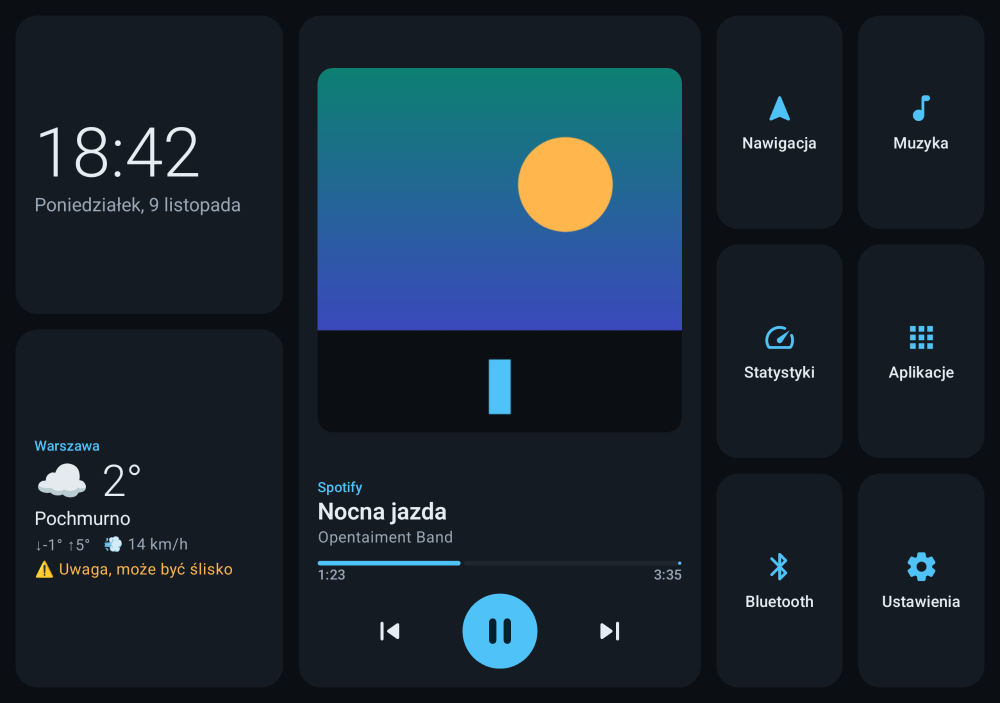
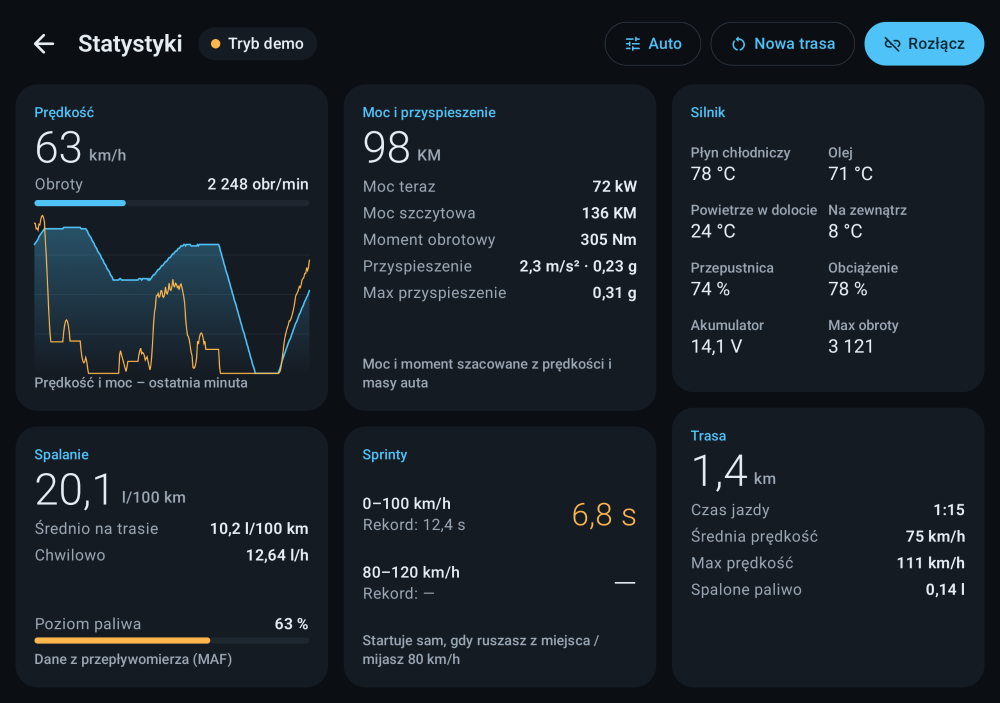
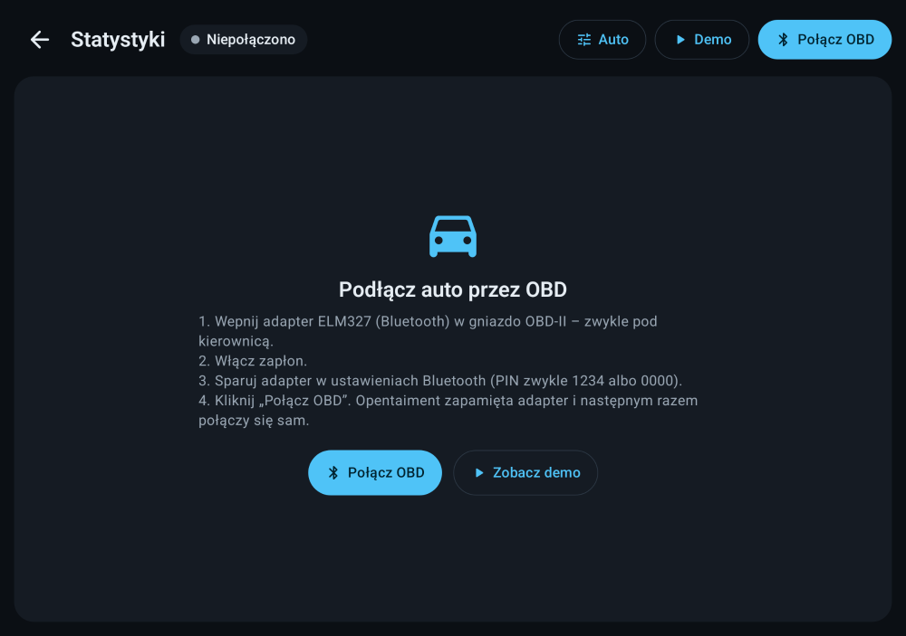
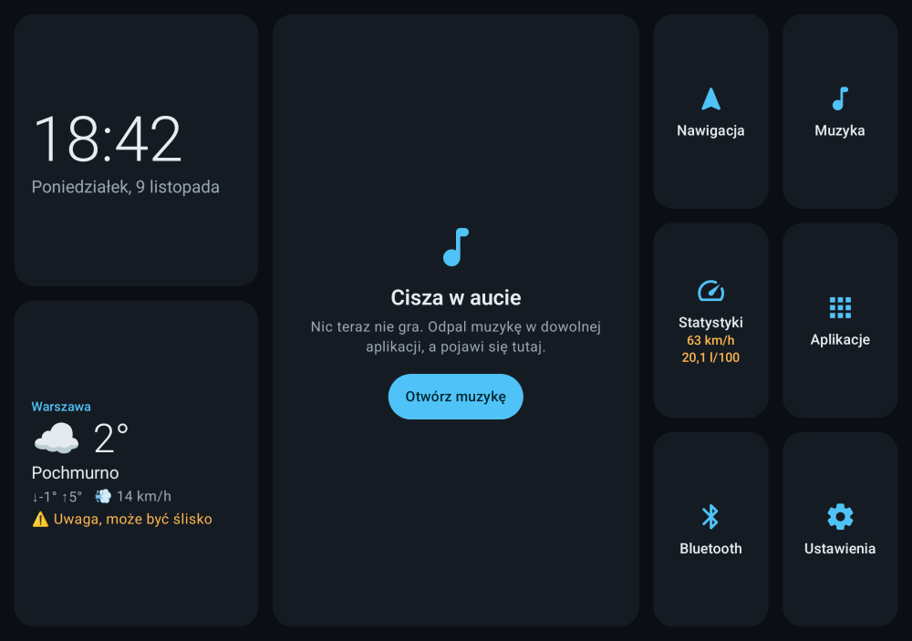
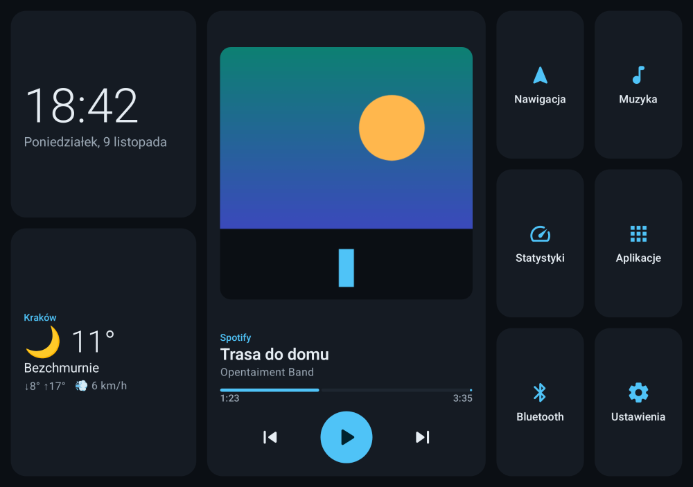
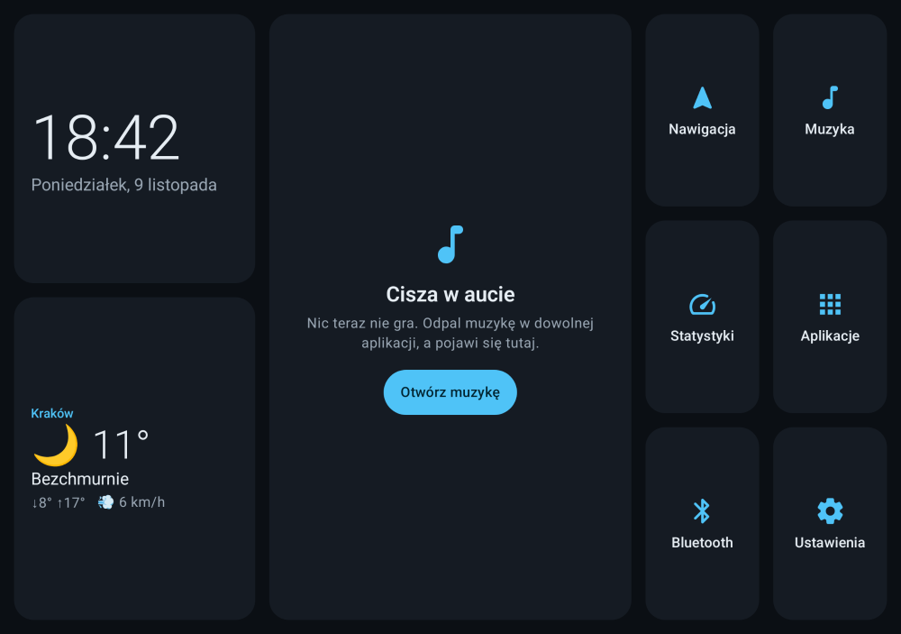
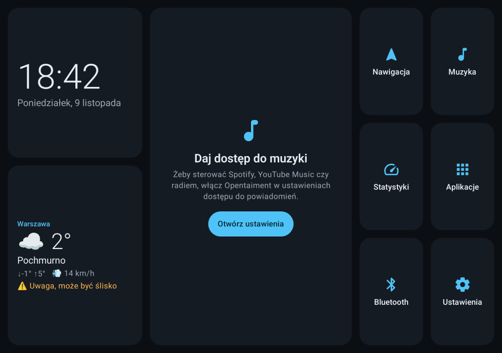
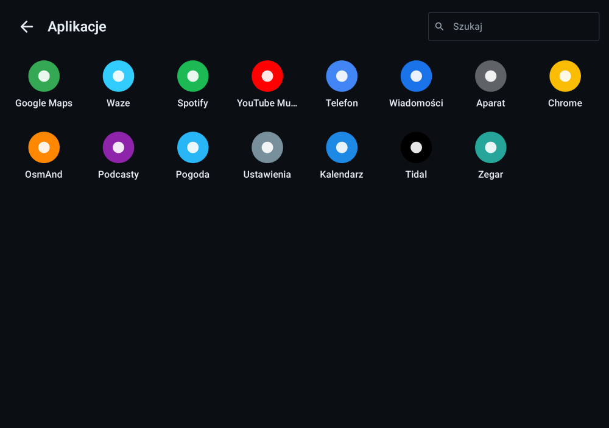
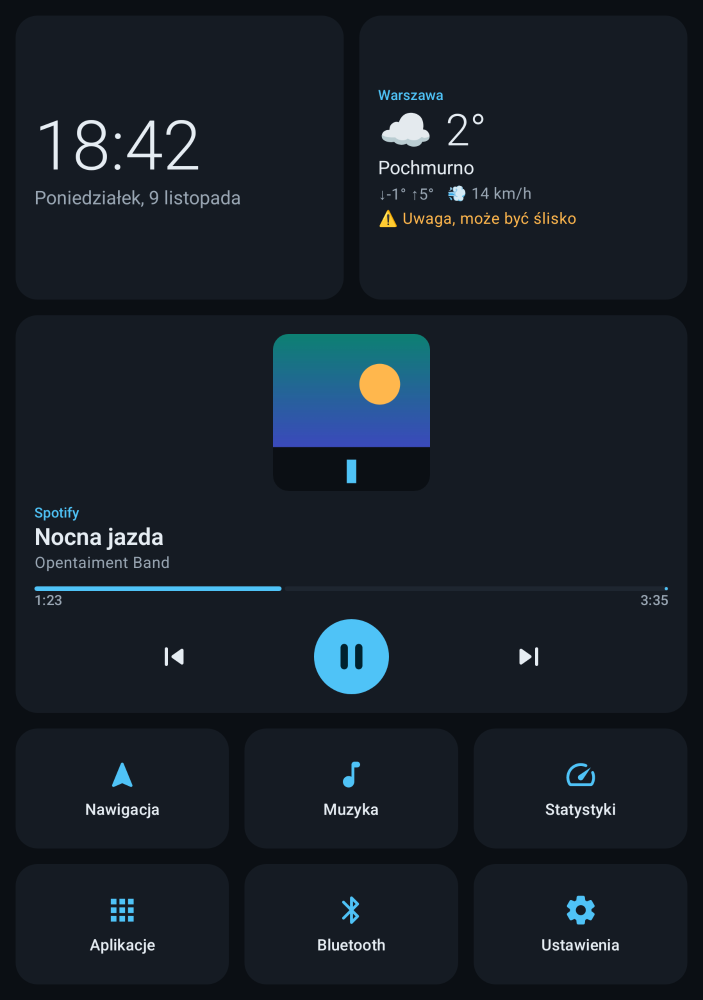

# Opentaiment

Otwarty system infotainment do samochodu dla Androida i Android Auto.

- 🚗 **Head unit / tablet** – pełnoekranowy launcher na tablet z Androidem (albo radio z Androidem). **← jesteśmy tutaj (v0.1)**
- 📱 **Telefon + Android Auto** – moduły wyświetlane na ekranie auta przez Android Auto (następny etap).



## Co już działa (v0.1 – tablet)

- Ekran główny: zegar, data, pogoda (Open-Meteo, bez klucza API, ostrzeżenie o śliskiej drodze)
- Sterowanie muzyką z **dowolnej** aplikacji (Spotify, YouTube Music, Tidal, radio…): okładka, tytuł, postęp, play/pauza/następny/poprzedni
- **Statystyki z OBD-II** (adapter ELM327 Bluetooth): spalanie chwilowe i średnie, moc i moment (szacowane), przyspieszenie, automatyczny pomiar 0–100 i 80–120 km/h z rekordami, temperatury, napięcie, poziom paliwa, licznik trasy, wykres ostatniej minuty. Jest **tryb demo** bez auta.
- Skróty: nawigacja (Google Maps → Waze → OsmAnd), muzyka, statystyki, Bluetooth, ustawienia
- Lista aplikacji z wyszukiwarką
- Tryb launchera (można ustawić jako ekran główny), ekran nie gaśnie, ukryte paski systemowe
- Układ poziomy i pionowy

## Statystyki (OBD-II)



| | |
|---|---|
|  |  |
| Instrukcja podłączenia adaptera | Podczas jazdy kafelek na ekranie głównym pokazuje prędkość i spalanie |

**Co jest potrzebne:** adapter ELM327 na Bluetooth (tzw. „kostka OBD”, ~30–80 zł), wpięty w gniazdo OBD-II
(każda benzyna od 2001 i diesel od 2004 w UE). Sparuj go w ustawieniach Bluetooth, potem *Statystyki → Połącz OBD*.
Adapter jest zapamiętywany i przy następnym starcie aplikacja łączy się sama.

**Skąd biorą się liczby:**

| Wartość | Źródło |
|---|---|
| Spalanie | PID 5E (jeśli auto go ma) → przepływomierz MAF → ciśnienie w kolektorze MAP (z pojemności silnika). Wykrywa odcięcie paliwa przy hamowaniu silnikiem. |
| Przyspieszenie | Regresja liniowa prędkości z ostatnich 1,5 s |
| Moc, moment | Szacowane z fizyki: masa × przyspieszenie + opory toczenia + opór powietrza, ÷ sprawność układu napędowego. Najdokładniejsze przy pełnym gazie na płaskim. |
| 0–100, 80–120 | Start/meta interpolowane między próbkami, przerywane gdy odpuścisz gaz |

W *Statystyki → Auto* ustaw rodzaj paliwa, masę i pojemność silnika, bo bez tego moc i spalanie będą mniej dokładne.

## Screeny (v0.1)

| | |
|---|---|
|  |  |
| Gra muzyka, zimno → ostrzeżenie o śliskiej drodze | Pauza, wieczór, bezchmurnie |
|  |  |
| Nic nie gra | Pierwsze uruchomienie – trzeba dać dostęp do muzyki |
|  |  |
| Lista aplikacji z wyszukiwarką | Tablet w pionie |

Screeny są generowane z kodu (Paparazzi, bez emulatora): `./gradlew :app-headunit:recordPaparazziDebug`

## Instalacja na tablecie

1. Pobierz APK z zakładki **Actions → ostatni build → artefakt `opentaiment-headunit-debug`**
   albo zbuduj sam: `./gradlew :app-headunit:assembleDebug`
   (plik: `app-headunit/build/outputs/apk/debug/app-headunit-debug.apk`).
2. Zainstaluj (`adb install app-headunit-debug.apk` albo skopiuj plik na tablet i otwórz).
3. Przy pierwszym uruchomieniu zezwól na lokalizację (pogoda dla Twojego miasta).
4. Kliknij **„Otwórz ustawienia”** na karcie muzyki i włącz Opentaiment w *Dostęp do powiadomień* – bez tego Android nie pozwala sterować muzyką z innych aplikacji.
5. (Opcjonalnie) Ustawienia → Aplikacje → Aplikacja domyślna → **Ekran główny → Opentaiment**, żeby tablet startował od razu w trybie auta.

## Struktura

```
app-headunit/      launcher na tablet / head unit
core/ui/           motyw i wspólne komponenty
feature/media/     sterowanie sesjami mediów
feature/weather/   pogoda (Open-Meteo)
feature/apps/      lista aplikacji i skróty
feature/vehicle/   OBD-II (ELM327), obliczenia, symulator jazdy, ekran statystyk
```

Testy: `./gradlew testDebugUnitTest` · zrzuty ekranu bez emulatora: `./gradlew :app-headunit:recordPaparazziDebug`

Plan i architektura: [docs/PLAN.md](docs/PLAN.md)
